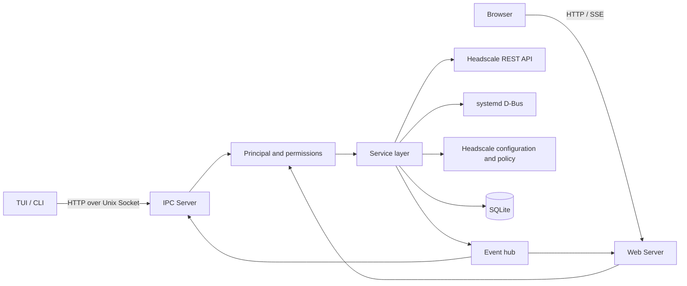

# Architecture

This document describes the current implementation. Product constraints are in [Requirements](requirements.md); request contracts are in [API](api/README.md).

## Components



The daemon owns resource, configuration and service operations. It connects directly to Headscale's local Unix management socket over gRPC, without an API key, CLI subprocesses or changes to the Headscale database. Socket ownership and permissions restrict access to local service identities; Web authorization remains in Headdeck's service layer. The connection is reused, reconnects after service restarts and closes during daemon shutdown. Reads may retry transient unavailability; writes are never replayed after an uncertain outcome. `internal/headscale/rpc` contains only the protocol messages used by Headdeck, generated from its local wire-compatible schema. It does not depend on the Headscale Go module. The public `/version` endpoint supplies optional version metadata over local HTTP without credentials; management and health checks use the Unix socket.

TUI/CLI use IPC. Web handlers call the same service layer within the daemon process rather than making another IPC request. The browser never connects to the Headscale management socket.

Web uses a single domain root and always proxies Headscale HTTP requests. The TLS endpoint forwards to Headdeck's Web listener; Headdeck serves `/`, `/assets/*`, its `/api/*` routes and its OIDC issuer. `/api/v1/*`, the exact `/oidc/callback` path and other Headscale paths go to the local listener read from Headscale's configuration. This keeps the broker callback separate from Headscale's callback and supports streaming and the Tailscale control-protocol upgrade through Go's reverse proxy. Login and registration paths require takeover readiness. The proxy forwards client authorization without injecting management credentials, strips Headdeck cookies in both directions, and rebuilds forwarded headers from the configured public URL and trusted client address. Streaming responses and upgraded connections have no Web response timeout. Shutdown cancels proxy requests, closes upgraded connections and releases idle upstream connections.

For example, an external [Caddy reverse proxy](https://caddyserver.com/docs/caddyfile/directives/reverse_proxy) only needs:

```caddyfile
ts.example.com {
    reverse_proxy 127.0.0.1:8088
}
```

Set `server.web.public_url` to `https://ts.example.com`; Headdeck synchronizes Headscale's `server_url` automatically. Its upstream comes from Headscale's `listen_addr`, with wildcard listeners changed to loopback while preserving the port. Headdeck and Headscale must use different internal listening ports. TLS terminates at Headdeck or its reverse proxy; the local Headscale listener uses HTTP. Trust only the TLS proxy's address in `server.web.trusted_proxies`. An `/admin` deployment path is not needed. Connection credentials and HTTP timeout/retry parameters are managed internally rather than exposed as settings.

## Package boundaries

| Location | Responsibility |
| --- | --- |
| `cmd/hdkt`, `internal/command` | Entry point, commands, installation, local authorization and daemon lifecycle |
| `internal/daemon` | Dependency assembly, listeners, reload and shutdown |
| `internal/ipc` | DTOs, client, transport, HTTP handlers and shared SSE output |
| `internal/web` | Web sessions, login, personal security, HTTP APIs, status SSE and embedded assets |
| `internal/auth` | Local grants, Principal, role policy, accounts and OAuth/OIDC adapters |
| `internal/service` | Resource operations, ownership, bindings, snapshots, differences and asynchronous operations |
| `internal/headscale` | REST client and upstream adaptation |
| `internal/servicecontrol`, `internal/processinfo` | systemd D-Bus, service state and process metrics |
| `internal/config`, `internal/database` | Headdeck settings and database access |
| `internal/headscale/config`, `internal/policyedit` | Configuration takeover, drafts and structured policy editing |
| `internal/headscale/identity` | Offline identity updates, private database snapshots and takeover journals |
| `internal/events` | Bounded history, subscriptions, replay and stream admission |
| `internal/tui` | Bubble Tea pages, layouts, forms and input |
| `web/src` | React pages, HeroUI components, resource cache, subscriptions and localization |

Transport handlers authenticate, decode, enforce permissions and encode responses. The service layer enforces resource relationships and mutation rules. Upstream data is converted into Headdeck DTOs before exposure.

## Authentication and ownership

IPC reads Unix peer credentials and resolves the UID against a root-controlled allowlist. Socket access alone does not grant authorization. Web sessions resolve current account roles, Headscale bindings and security revisions.

Role policy is centralized in `internal/auth/policy`. Members are scoped to their bound Headscale user ID, and mutations check ownership again. Account and provider administration requires owner access; `server.web.*` settings also require owner access.

Accounts, password usernames, external identities and Headscale links are separate records. Identities use an issuer/subject key, and Headscale links are unique. User synchronization handles renames and removed users. Security revision changes invalidate old account sessions.

## Storage and deployment

| Default path | Purpose |
| --- | --- |
| `/usr/local/bin/hdkt` | CLI, TUI, daemon and embedded Web assets |
| `/run/headdeck/ipc.sock` | Local IPC |
| `/etc/headdeck/users.json` | Local authorization |
| `/var/lib/headdeck/settings.db` | Settings, accounts, credentials, sessions and configuration drafts |
| Key files under `/var/lib/headdeck` | Session and OIDC signing keys; paths belong to local installation configuration |
| `/etc/systemd/system/headdeck.service` | Daemon service unit |

The current installation template runs the daemon as root with capability and system resource restrictions. Ordinary clients remain unprivileged. Service control uses D-Bus, and process metrics use system interfaces. Local authorization and configuration takeover use sudo without a Polkit dependency.

SQLite is accessed through package-specific stores; settings and account persistence use GORM. Schema setup creates missing tables and does not maintain legacy migrations. Web sessions combine a signed Cookie with database session digests, preserving login across reloads and supporting individual revocation. The server owns the expiry, with a seven-day idle lifetime by default. Normal authenticated GET requests renew sessions in the second half of their lifetime; background event streams do not. Conditional expiry updates preserve the Cookie, device ID and original authentication time without recreating sessions or reviving revoked records.

## Configuration changes

Headdeck settings are validated and atomically saved, then request a daemon reload. Reload waits for active service/configuration operations, closes old components and assembles new listeners. Clients may briefly reconnect; this does not restart Headscale.

File paths and the controlled systemd unit cannot be changed through Web or IPC, including by owners. Key and database files require trusted ownership and protected parent directories. Managed configuration writes and rollbacks remain inside the authorized directory, reject executable files, and restore only files changed by the operation. Headscale API requests do not follow redirects. Proxy-derived client addresses are resolved from the nearest untrusted hop.

Headscale settings, DNS and policy use revision-controlled drafts. Save checks the revision. Apply serializes file writes, any required service restart and health checks. Success clears the draft; failure restores the previous configuration and reports recovery status. Configuration takeover backs up original files. HTTP acceptance does not imply completion.

## SSE and client caching

Both status and resource events use SSE. A status stream sends an initial snapshot and then changed top-level fields. Real status samples occur every 15 seconds; each client advances uptime from its last real sample without additional requests. The TUI samples status on the same interval and uses SSE for resource events. Web closes overview streams on navigation or tab hiding.

Node and user snapshots carry collection revisions. Event IDs support replay; a collection difference's `base_revision` determines whether it can be applied. Expired history, instance changes or mismatched revisions require a new snapshot. Key and route events may be invalidation notices rather than collection differences.

History is capped at 256 events and 8 MiB; individual event data is limited to 512 KiB. Status and resource streams share a limit of 64 connections. Slow subscribers are disconnected when their queues overflow. Removed history references are cleared. Operation history retains at most 128 entries and is lost on reload. Temporary authentication state holds at most 1024 entries with a five-minute lifetime.

Web resource data stays in memory. Each visit displays cached data immediately and refreshes once in the background. Administrators receive further updates through resource events. Members use GET on visits and manual refreshes, with no event connection or periodic resource polling. Reconnection, expired history and revision gaps trigger snapshot recovery for subscribers. Cached resources and in-flight requests are each capped at 64, and same-path requests are merged. Page modules preload during idle time without fetching resource data or blocking navigation. Cached data is never an authorization source.

Web diagnostics are opt-in (`server.diagnostics=false` by default). The backend checks the persisted setting before accessing upstream or cached data. Administrators and owners may change it through the existing settings API, Web or TUI. Disabled pages do not fetch diagnostic data or load the chart library. When enabled, diagnostics use the local `metrics_listen_addr` separately from Headscale's control and Unix management connections. Only sessions with `system.read` may request a fixed set of read-only metric/debug sections. Upstream responses are bounded to 4 MiB, have a three-second timeout and share a ten-second daemon cache. The browser loads the selected section on access or manual refresh, without periodic polling. Raw Prometheus text is not returned; debug output is text, never executable HTML. Configuration dumps and active diagnostic operations are excluded.

The daemon keeps at most 120 metric snapshots from the last hour in memory for ECharts trend views. Only actual upstream reads add samples. Headscale process restarts reset this history, and missing measurements remain gaps rather than interpolated values.

Headdeck also exposes the Go standard pprof handlers under `/api/debug/pprof/`, guarded by the same opt-in setting and administrator permissions. Profiles are collected only on explicit requests, with the `seconds` parameter limited to 1–30 seconds. These routes use the application's authenticated router rather than a separate public debug listener.

The daemon monitors Headscale REST resources while subscribers are connected, because this integration has no upstream watch endpoint. This shared polling detects external changes and publishes differences to subscribed administrators. Draft, account and provider mutations publish invalidations immediately. Member GET requests still enforce ownership and never start a background resource watcher on their own.

## Headscale OIDC provider

Headdeck logging in through an external OIDC provider and Headdeck acting as an OIDC provider for Headscale are separate features.

The target login path is GitHub → Headdeck → Headscale, without Dex. Headscale trusts `<server.web.public_url>/oidc`; GitHub, other configured providers and local credentials authenticate Headdeck accounts. The broker accepts the configured client and exact redirect URI, uses authorization-code login with PKCE, and persists signing keys and authorization records. Its subject is the stable Headdeck account ID, independent of the external provider or nickname.

Web and password login default to disabled. Configure the public HTTPS URL and login methods through CLI/TUI. Enabling Web also enables the mandatory broker: its client ID is fixed to `headscale`, its callback follows `<public_url>/oidc/callback`, its token lifetime is one hour, and its secret is generated once and persisted in the settings database. Broker parameters have no manual settings entry. `hdkt settings apply` accepts a JSON object of string values on standard input for atomic setup. Web API requests and OIDC authorization/token validation require authorized Headscale configuration, the matching issuer/client/secret and S256 PKCE. Authorization restrictions belong to Headdeck rather than independent Headscale email/group lists. An incomplete takeover refuses login and protected API access while leaving local IPC and browser sign-out available. Once configuration matches, service management remains available when Headscale is stopped; the gate does not depend on API health.

Device login requires the Headscale user's provider identifier to equal `<issuer>/<account_id>`. The broker rechecks the account, security revision and upstream binding when issuing or using a token. The explicit account binding is authoritative; email and display names do not select an identity. The bound Headscale email is preserved and marked verified only when the current provider verified it. OIDC email claims are accepted only when the upstream provider verifies them.

Provider auto-registration creates a Headdeck account with `server.web.default_role`: `pending` for private deployments (the default), or `member` for public deployments. Only these two defaults are allowed; existing account roles are unchanged. Identity resolution always uses issuer and subject, including across multiple providers. Username collisions receive an account-specific suffix, invalid usernames receive a generated name, and concurrent attempts for the same identity resolve the committed account. Display names and verified emails never merge accounts. Browser sessions use HttpOnly/Secure cookies with SameSite=Lax to allow cross-site OAuth binding callbacks; state, PKCE, browser-bound flow secrets and mutation origin/header checks protect the flow.

Headscale registration is a separate step. With the default role set to `member`, an unbound member may complete a Tailscale device OIDC login using the Headdeck account ID as the subject. No Headscale user is created during Web signup. A conflicting Headscale username receives a unique suffix before authorization; existing same-name or same-email users are never claimed. Headscale creates its OIDC user during device login, and subsequent user snapshots or the waiting page's session refresh attach that user only when the exact issuer/account ID and reserved username match. Initial automatic binding preserves the session security revision so the in-flight token and userinfo exchange can finish. Members cannot access network resources until binding completes. With the default role set to `pending`, an owner must bind and approve the account before device login is permitted.

After the Web listener starts, the daemon automatically switches the Headscale issuer, public URL, listener and existing provider identifiers together. Every existing OIDC user must already have an explicit Headdeck account binding; an empty Headscale user database needs no initial binding. No separate login settings or takeover action is needed. Initial configuration management authorization still requires `sudo hdkt headscale config authorize`. Automatic management requires the privileged daemon, systemd and the local SQLite database at `/var/lib/headscale/db.sqlite`. Custom database locations, remote APIs, environment configuration overrides and PostgreSQL are not supported by this operation. Failures appear in `hdkt operations list` and leave Web login blocked; correct the configuration or bindings and reload the daemon to retry.

The daemon saves a private transaction journal, stops Headscale, edits a bounded private database copy using GORM, then installs it atomically with preserved file permissions and ownership. Only provider identity fields change; user IDs, names, emails and device ownership remain intact. It replaces the OIDC configuration with the Headdeck issuer, credentials and S256 PKCE, synchronizes the public URL and loopback listener, restarts Headscale and verifies the API identities before committing. Existing configuration drafts remain pending. An unchanged configuration and identity set do not restart Headscale. A managed Headscale that could not start before its issuer was available is started after Headdeck's listener opens.

On failure, rollback restores the configuration and provider fields in the current database, preserving any other records written since the switch. File and row conflicts refuse overwrite. On startup, an interrupted transaction is recovered before another takeover attempt. Web access remains blocked until management completes. Local owners can still use `hdkt headscale login recover` for manual recovery or `hdkt headscale login apply` to retry. Temporary database copies are removed after each attempt. Dex is not stopped automatically; disable it only after configuring a direct upstream provider, binding accounts and validating the new login flow.
